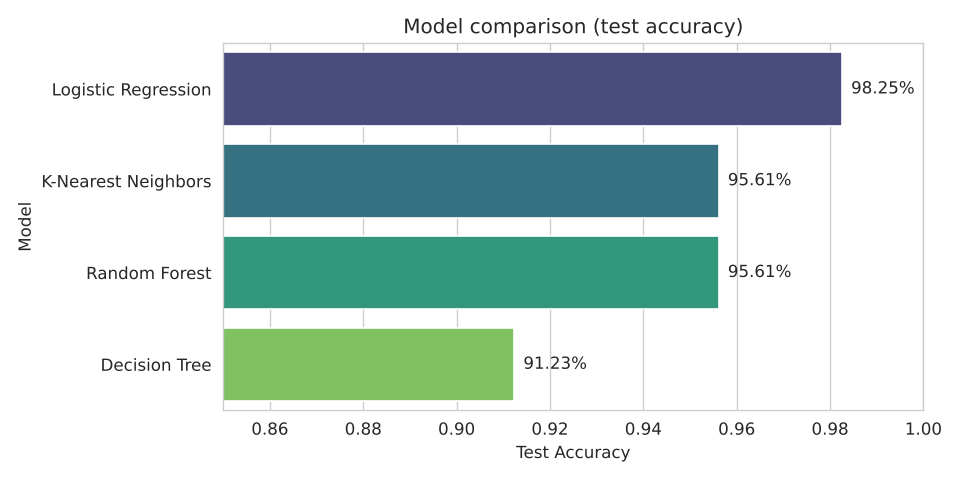
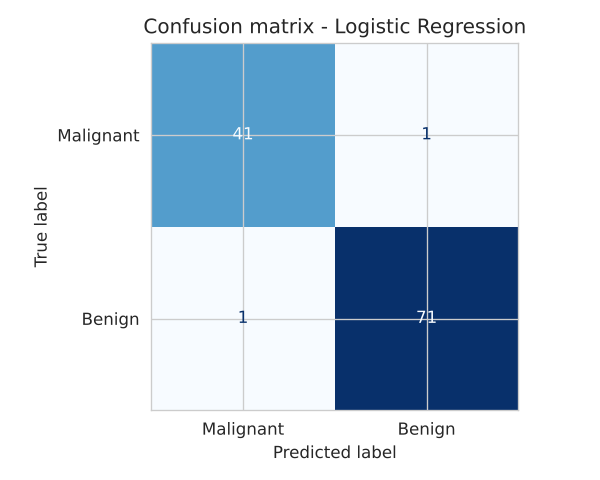
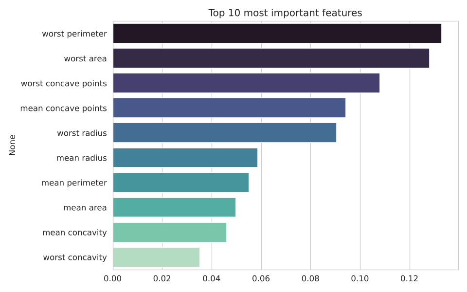
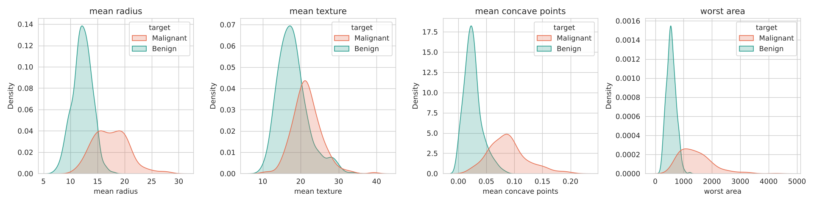

# 🩺 Breast Cancer Prediction using Machine Learning

A machine learning project that predicts whether a breast tumor is **malignant** (cancerous) or **benign** using 30 measurements of cell nuclei from the Wisconsin Breast Cancer dataset.

## 📌 Results

| Model | Cross-Validation Accuracy | Test Accuracy |
|---|---|---|
| **Logistic Regression** | **98.02%** | **98.25%** |
| K-Nearest Neighbors | 96.70% | 95.61% |
| Random Forest | 96.04% | 95.61% |
| Decision Tree | 90.99% | 91.23% |

**Best model: Logistic Regression** — 98% precision and 98% recall on malignant cases (only 1 of 42 cancer cases missed in the test set).



## 🔍 Project Workflow

1. **Data exploration** — 569 samples, 30 features, no missing values
2. **Visualization** — class distribution and feature distributions by diagnosis
3. **Preprocessing** — stratified 80/20 train-test split, `StandardScaler` (fitted on training data only, to avoid data leakage)
4. **Model training** — 4 classifiers compared with 5-fold cross-validation
5. **Evaluation** — accuracy, precision, recall, F1-score, confusion matrix
6. **Feature importance** — which measurements matter most

## 📊 Visualizations

| Confusion Matrix | Top Features |
|---|---|
|  |  |



## 💡 Key Insights

- In medical diagnosis, **recall for the malignant class** is the most important metric — a missed cancer case is far worse than a false alarm.
- A simple, well-scaled linear model outperformed more complex models on this small, clean dataset.
- Tumor size and shape features (**worst perimeter, worst area, worst concave points**) are the strongest predictors.

## 🛠️ Tech Stack

Python · Pandas · NumPy · Scikit-learn · Matplotlib · Seaborn · Jupyter Notebook

## ▶️ How to Run

```bash
git clone https://github.com/YOUR-USERNAME/breast-cancer-prediction.git
cd breast-cancer-prediction
pip install -r requirements.txt
jupyter notebook breast_cancer_prediction.ipynb
```

The dataset is built into scikit-learn, so no download is needed.

## 🚀 Future Improvements

- Hyperparameter tuning with GridSearchCV
- Try SVM and XGBoost
- Deploy as a web app using Streamlit

## 📚 Dataset

[Breast Cancer Wisconsin (Diagnostic) Dataset](https://archive.ics.uci.edu/dataset/17/breast+cancer+wisconsin+diagnostic) — UCI Machine Learning Repository
